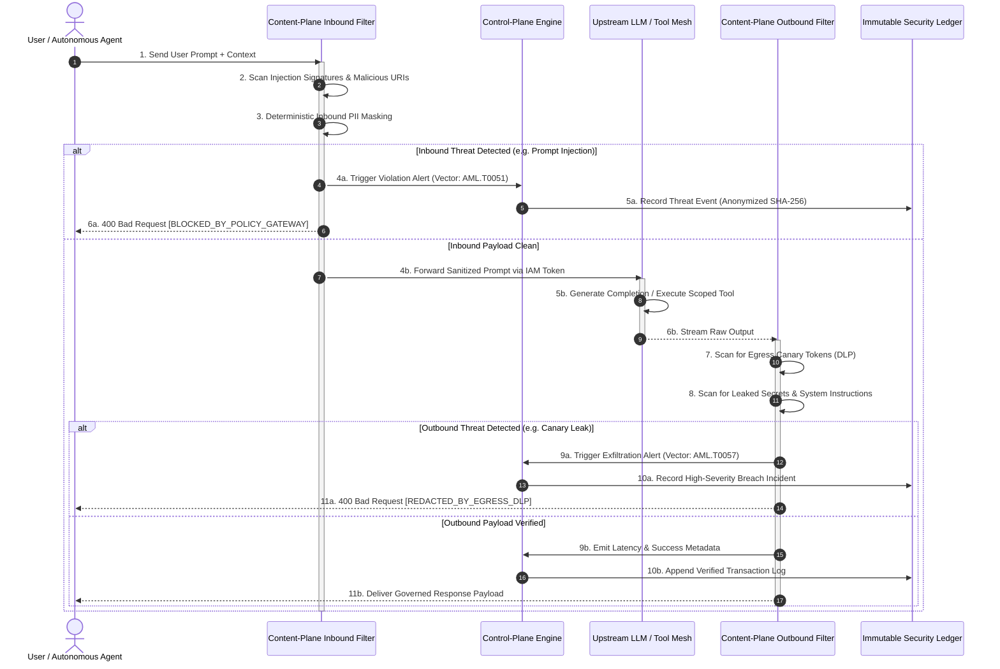

# Triad AI Governance Mesh: Architecture Blueprint

**Classification:** Sovereign Reference Architecture  
**Author:** Shibin Antony ([github.com/shibinantony](https://github.com/shibinantony))  
**Standards Compliance:** NIST AI RMF 1.0 | MITRE ATLAS | OWASP Top 10 for LLMs | ISO/IEC 42001  

---

## 1. Executive Architectural Thesis

Enterprise AI initiatives routinely stall in pilot purgatory or fail security reviews because organizations treat AI security as an ad-hoc wrapper rather than a foundational engineering lifecycle. Modern generative AI and autonomous agentic systems operate as non-deterministic execution environments. Traditional network firewalls and static API gateways are fundamentally blind to semantic attack vectors such as prompt injection, indirect instruction hijacking, and egress canary leakage.

Conversely, deploying disconnected runtime filters without design-time risk assessment or empirical adversarial verification creates an illusion of security.

The **Triad AI Governance Mesh** solves this systemic failure by unifying three interdependent lifecycle layers into an immutable, cloud-agnostic architecture:

1. **Advisory Toolbox (Design-Time Posture & Scoping):** Machine-readable evaluation of Technical Attack Vectors against Operational Blast Radius, establishing deterministic gating rules.
2. **AI Red Teaming Engine (Pre-Production Assurance):** Automated multi-turn adversarial harnesses (built on PyRIT architectural patterns) generating cryptographic evidence of defense efficacy before production release.
3. **Model Armor Runtime (Runtime Policy-as-Code Enforcement):** A cloud-agnostic interceptor mesh decoupling the **Content-Plane** from the **Control-Plane**, enforcing floor settings across Google Cloud Model Armor, AWS Bedrock Guardrails, and Azure AI Content Safety.

```
                    ┌────────────────────────────────────────┐
                    │       01. ADVISORY TOOLBOX             │
                    │   - Risk & Blast Radius Matrix         │
                    │   - NIST / MITRE ATLAS / OWASP Mapping │
                    └──────────────────┬─────────────────────┘
                                       │ (Defines Policies & Floor Settings)
                                       ▼
┌──────────────────────────────────────┴──────────────────────────────────────┐
│                         03. MODEL ARMOR RUNTIME                             │
│                                                                             │
│  [Client / Agent]                                                           │
│         │                                                                   │
│         ▼                                                                   │
│  ┌────────────────────────┐                   ┌──────────────────────────┐  │
│  │ Content-Plane Inbound  │──(Violation?)────►│ Control-Plane Audit Bus  │  │
│  │ - Prompt Injection     │   [HTTP 400]      │ - Immutable JSON Telemetry│  │
│  │ - PII / Secret Mask    │                   │ - Cryptographic Ledger   │  │
│  │ - Malicious URIs       │                   └──────────────────────────┘  │
│  └──────────┬─────────────┘                                 ▲               │
│             │ (Sanitized Prompt)                            │               │
│             ▼                                               │               │
│  ┌────────────────────────┐                                 │               │
│  │ Upstream LLM Inference │                                 │               │
│  │ + IAM-Bounded Tool Exec│                                 │               │
│  └──────────┬─────────────┘                                 │               │
│             │ (Raw Response)                                │               │
│             ▼                                               │               │
│  ┌────────────────────────┐                                 │               │
│  │ Content-Plane Outbound │──(Canary / Leak?)───────────────┤               │
│  │ - Egress Canary DLP    │   [HTTP 400]                    │               │
│  │ - Secret / PII Masking │                                 │               │
│  │ - Tool Command Filter  │                                 │               │
│  └──────────┬─────────────┘                                 │               │
│             │ (Verified Response)                           │               │
│             ▼                                               │               │
│       [Application]                                         │               │
└─────────────────────────────────────────────────────────────┼───────────────┘
                                                              │
                       ▲                                      │
                       │ Continuous Adversarial Feedback      │
                       │ (Failure Signatures & New Payloads)  │
                       │                                      │
        ┌──────────────┴────────────────────────┐             │
        │       02. RED TEAMING ENGINE          │             │
        │   - PyRIT Multi-Turn Runner           │◄────────────┘
        │   - ATLAS-Mapped Attack Scenarios     │
        │   - Cryptographic Evidence Reports    │
        └───────────────────────────────────────┘
```

---

## 2. Content-Plane vs. Control-Plane Isolation

The central architectural pattern of the Triad Mesh is the strict cryptographic and physical isolation of the **Content-Plane** from the **Control-Plane**.

### 2.1 The Content-Plane (Data & Semantic Execution)
- **Scope:** Processes the raw tokens, conversational contexts, multi-turn chat histories, retrieved RAG context documents, model completions, and tool execution parameter payloads.
- **Responsibility:** In-line payload interception, streaming sanitization, deterministic regex redaction, and semantic classifier inspection.
- **Memory Boundary:** Ephemeral memory execution only. Zero persistent caching of unmasked user context. Data minimization principles are applied before upstream forwarding.

### 2.2 The Control-Plane (Policy, Telemetry & Identity)
- **Scope:** Evaluates policy conditions, risk blast radius tiers, IAM credential issuance, fail-closed circuit breakers, and immutable audit records.
- **Responsibility:** Deterministic policy decisioning (ALLOW, BLOCK, REDACT, ESCALATE-TO-HITL).
- **Isolation Guarantee:** The Control-Plane never ingests unmasked raw prompt tokens. Telemetry events emitted to security operations (SIEM/SOAR) contain only anonymized metadata, scenario IDs, latency timings, and cryptographic hash signatures.



---

## 3. Request Lifecycle & Latency Budgets

In enterprise production environments, security controls cannot introduce unbounded latency overhead. The Triad Mesh establishes an absolute evaluation latency ceiling:

$$\text{Total Interception Latency} \le 15\text{ ms} \quad (\text{Target: } 8\text{ ms})$$

### Latency Budget Breakdown:
1. **Pre-Inference Inbound Filter (Content-Plane): $\le 6\text{ ms}$**
   - Compiled regex PII scanning (Aho-Corasick / DFA execution): $1.8\text{ ms}$
   - Malicious URI & SSRF validator: $0.7\text{ ms}$
   - Heuristic injection classifier & delimiter boundary verification: $3.5\text{ ms}$
2. **Upstream Inference & Tool Execution (Variable):** Dependent on upstream model provider ($200\text{ ms} - 1200\text{ ms}$).
3. **Post-Inference Outbound Filter (Content-Plane): $\le 5\text{ ms}$**
   - Canary token signature matching: $1.2\text{ ms}$
   - Egress PII & API secret redaction: $2.1\text{ ms}$
   - Unauthorized tool verb suppressor: $1.7\text{ ms}$
4. **Control-Plane Telemetry Dispatch (Asynchronous): $0\text{ ms}$ blocking**
   - Telemetry events are offloaded to background worker queues (Kafka / Event Hubs / Pub/Sub) via non-blocking zero-copy threads.

---

## 4. The Critical Boundary: Content Filters vs. IAM & Identity

> [!IMPORTANT]
> **Architectural Law:** Content filters and prompt shields alone CANNOT secure autonomous agents. A model protected solely by content filters will inevitably be subverted if its connected tools possess excessive agency or shared ambient credentials.

A prompt injection attack is simply an untrusted input vector. If the LLM has access to a tool with administrative database credentials, a bypass of the prompt filter results in immediate remote execution or data destruction.

The Triad AI Governance Mesh enforces **Identity Enclosure**:
1. **Zero Ambient Credentials:** The LLM agent operates under zero static credentials. API keys are never stored in system prompts or agent environment variables.
2. **Per-Invocation Step-Up Tokens:** Tools executing state-mutating actions (write, update, delete, wire dispatch) require short-lived, cryptographically signed OIDC tokens.
3. **Dual-Custody Human-in-the-Loop (HITL):** When an archetype's Operational Blast Radius is classified as `HIGH` or `CRITICAL` (per `risk-blast-radius-matrix.yaml`), the gateway halts execution and requires an out-of-band cryptographic signature from an authorized human operator before tool execution resumes.
4. **Read-Only Enclaves:** Unsupervised agents are strictly confined to read-only IAM roles with row-level security (RLS) and virtual private cloud (VPC) service controls.

---

## 5. Threat Modeling: MITRE ATLAS & OWASP LLM Mapping

The architecture directly mitigates the full spectrum of MITRE ATLAS tactics and OWASP Top 10 for LLM risks:

| MITRE ATLAS Technique | OWASP Code | Attack Description | Triad Mesh Mitigation |
| :--- | :--- | :--- | :--- |
| **AML.T0051** (LLM Prompt Injection) | **LLM01** | Adversary crafts inputs to override system directives | Content-Plane Inbound Filter & Multi-Cloud Prompt Shields |
| **AML.T0051.001** (Indirect Prompt Injection) | **LLM01** | Poisoned RAG document or external web scrape alters execution | Pre-ingestion RAG Document Scanner & Delimiter Isolation |
| **AML.T0057** (LLM Data Exfiltration) | **LLM02** | Egress of sensitive customer data or internal embeddings | Outbound DLP Filter & Cryptographic Canary Token Matching |
| **AML.T0058** (System Prompt Extraction) | **LLM07** | Probing prompts force model to leak meta-instructions | System Instruction Semantic Embeddings Distance Gate |
| **AML.T0053** (LLM Tool Misuse) | **LLM06** | Model tricked into invoking destructive system commands | IAM Step-Up Verification & Destructive Verb Interception |
| **AML.T0040** (ML Supply Chain Compromise) | **LLM03** | Malicious packages, untrusted adapters, or poisoned models | Immutable GitOps Terraform Templates & Signed Artifacts |

---

## 6. Multi-Cloud Policy Federation

Enterprise estates are heterogeneous. The Triad Mesh provides identical declarative floor settings regardless of whether workloads execute in GCP, AWS, or Azure:

```
                      Triad Abstract Policy Schema
                   (01-advisory-toolbox/risk-matrix)
                                  │
         ┌────────────────────────┼────────────────────────┐
         │                        │                        │
         ▼                        ▼                        ▼
[GCP Model Armor]        [AWS Bedrock Guardrails]   [Azure AI Content Safety]
 - google_model_armor     - aws_bedrock_guardrail    - prompt_shield_policy
 - Mandatory Floor Set     - Sensitive Info Policy   - Document Analysis
 - Location: us-central1  - Location: us-east-1     - Location: East US
```

### 6.1 Tool-by-Tool Comparison: AWS : GCP : Azure

| Dimension | AWS (Amazon Bedrock Guardrails) | GCP (Google Cloud Model Armor) | Azure (Azure AI Content Safety) |
| :--- | :--- | :--- | :--- |
| **Primary Managed Service** | **Amazon Bedrock Guardrails** | **Google Cloud Model Armor** | **Azure AI Content Safety** |
| **Prompt Injection Defense** | Configurable strength Prompt Attack filter | Integrated Prompt Injection Shield | Dedicated Prompt Shields (Direct & Indirect) |
| **PII & Sensitive Data DLP** | 30+ native PII entities (Anonymize/Block) | Cloud DLP / Sensitive Data Protection engine | PII regex matching & Purview integration |
| **Groundedness / Hallucination** | Built-in Grounding & Relevance filters | Paired with Vertex AI Search Grounding | Dedicated Groundedness Detection API |
| **Custom Blocklists & Topics** | Natural-language topic definitions + words | Dictionary templates + 4 RAI categories | Custom Blocklists + 4-level severities |
| **Non-Native Model Support** | Supported via `ApplyGuardrail` API | Supported via Model Armor REST APIs | Standalone REST service; model-agnostic |
| **IaC Implementation** | [`aws-bedrock-guardrails/guardrail.tf`](file:///c:/Users/shibi/OneDrive/Desktop/AI_IP/Gov_Traids/triad-ai-governance-mesh/03-model-armor-runtime/aws-bedrock-guardrails/guardrail.tf) | [`gcp-model-armor/template.tf`](file:///c:/Users/shibi/OneDrive/Desktop/AI_IP/Gov_Traids/triad-ai-governance-mesh/03-model-armor-runtime/gcp-model-armor/template.tf) | [`azure-content-safety/prompt_shield_policy.json`](file:///c:/Users/shibi/OneDrive/Desktop/AI_IP/Gov_Traids/triad-ai-governance-mesh/03-model-armor-runtime/azure-content-safety/prompt_shield_policy.json) |

Every cloud implementation enforces identical floor thresholds:
- Direct Prompt Attack: `STRICT_BLOCK`
- Indirect RAG Document Poisoning: `STRICT_BLOCK`
- High-Risk PII Entities: `REDACT_OR_ANONYMIZE`
- Diagnostic Canary Leakage: `FAIL_CLOSED_HALT`

---

## 7. Failure Modes & Operational Resilience

### 7.1 Fail-Closed vs. Fail-Open Architecture
- **Critical & High Blast Radius Workloads:** Enforce strict **Fail-Closed** design. If the Policy Gateway or underlying Model Armor provider experiences a timeout ($> 15\text{ ms}$), network partition, or internal error, the transaction is immediately rejected with a deterministic `503 Service Unavailable` response.
- **Low Blast Radius Workloads:** May optionally fail-open to a cached local deterministic filter with enhanced background audit alerting.

### 7.2 The Continuous Adversarial Feedback Loop
Security postures degrade over time without adversarial validation. The offline PyRIT Red Teaming Engine executes against staging endpoints on every CI/CD pull request. Any scenario that breaches a guardrail automatically generates an incident signature that is parsed and merged directly into the Policy Gateway regex and Terraform templates.

---

## 8. Summary of Engineering Artifacts

- **Advisory Blueprint:** [`risk-blast-radius-matrix.yaml`](file:///c:/Users/shibi/OneDrive/Desktop/AI_IP/Gov_Traids/triad-ai-governance-mesh/01-advisory-toolbox/risk-blast-radius-matrix.yaml)
- **Control Crosswalk:** [`nist-mitre-owasp-mapping.json`](file:///c:/Users/shibi/OneDrive/Desktop/AI_IP/Gov_Traids/triad-ai-governance-mesh/01-advisory-toolbox/nist-mitre-owasp-mapping.json)
- **Red Team Engine:** [`pyrit_adversarial_runner.py`](file:///c:/Users/shibi/OneDrive/Desktop/AI_IP/Gov_Traids/triad-ai-governance-mesh/02-red-teaming-engine/pyrit_adversarial_runner.py)
- **Runtime Policy Gateway:** [`policy_as_code_gateway.py`](file:///c:/Users/shibi/OneDrive/Desktop/AI_IP/Gov_Traids/triad-ai-governance-mesh/03-model-armor-runtime/policy_as_code_gateway.py)
- **GCP IaC:** [`template.tf`](file:///c:/Users/shibi/OneDrive/Desktop/AI_IP/Gov_Traids/triad-ai-governance-mesh/03-model-armor-runtime/gcp-model-armor/template.tf)
- **AWS IaC:** [`guardrail.tf`](file:///c:/Users/shibi/OneDrive/Desktop/AI_IP/Gov_Traids/triad-ai-governance-mesh/03-model-armor-runtime/aws-bedrock-guardrails/guardrail.tf)
- **Azure Policy:** [`prompt_shield_policy.json`](file:///c:/Users/shibi/OneDrive/Desktop/AI_IP/Gov_Traids/triad-ai-governance-mesh/03-model-armor-runtime/azure-content-safety/prompt_shield_policy.json)
